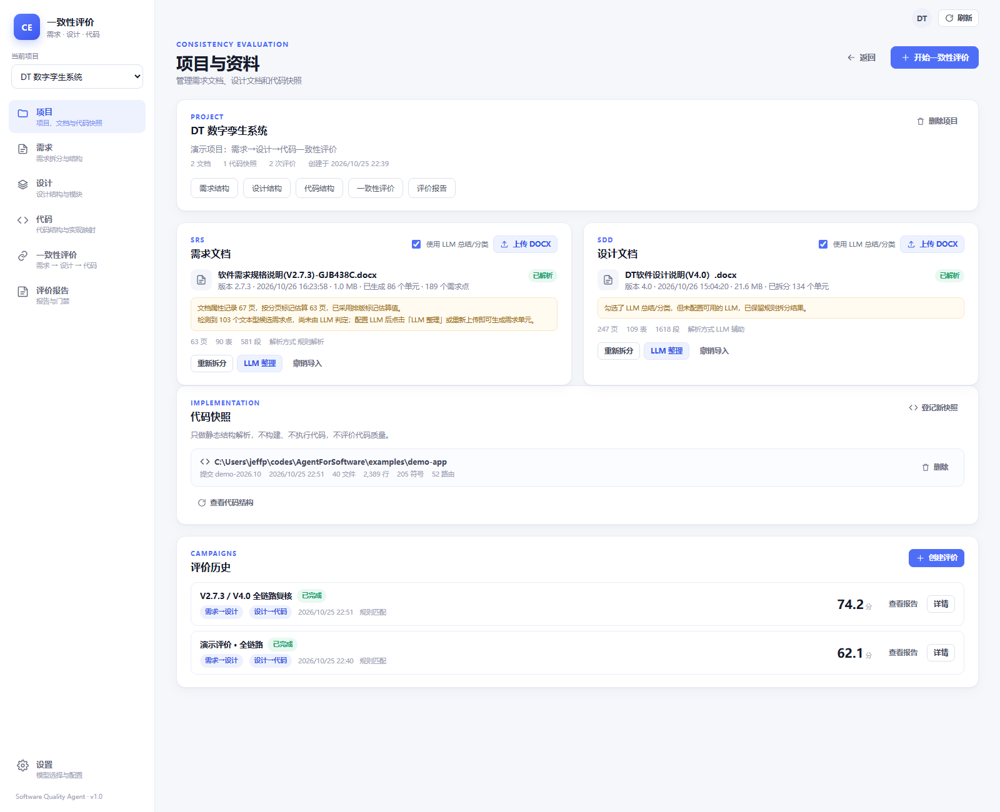

# 一致性评价 Agent · 需求 / 设计 / 代码

一个面向软件质量评价的本地 Web 应用：解析 DOCX 需求规格说明书（SRS）与软件设计说明书（SDD），把文档拆成可核验的**需求单元、设计单元与原子义务**；再通过 **LLM + 检索** 评价两条链路的一致性：

- **需求 → 设计**：设计是否完整覆盖需求的每一条原子义务。
- **设计 → 代码**：代码快照中是否存在与设计接口、输入输出、数据模型一致的实现。

前端 React + TypeScript，后端 Node.js + TypeScript；数据保存在本机，不需要数据库。



## 1. 从示例文档观察到的结构

本项目不是按某个固定模板硬编码，而是先从 `文档例子/` 中的两份真实文档归纳结构，再实现通用解析器。

### 1.1 需求文档（DT软件需求说明 V2.7.3）

需求拆分采用“先识别需求点，再生成需求单元”的两阶段流程，**不再根据章节名称决定需求类型**：

- **需求表直接成为规则需求点**：字段为 `需求ID | 父需求ID | 需求描述 | 需求说明 | 测试规程`，一张需求表就是一个需求点，来源 `rule`，置信度 `100%`。
- **只有文字描述的叶子章节/段落成为候选需求点**：例如 `3.5.2 外部系统接口`。这些文本由 LLM 判断是否构成需求点；来源 `llm`，置信度由 LLM 给出。
- **记录每一级带编号的章节路径**：例如 `3 需求分析 / 3.3 功能需求 / 3.3.1 XX气象装备数字孪生虚实融合系统平台功能需求 / 3.3.1.1 故障检测功能`。
- **LLM 统一归纳子系统分类**：统计全部需求点的章节路径，让 LLM 生成 3–8 个概括性的子系统类别，并建立“章节路径 → 类别”的映射；需求单元只使用这些类别，不再让每个单元自由生成子系统名。
- **所有需求点统一交给 LLM 生成需求单元**：标题、需求类型、摘要、原子义务、关键词由 LLM 根据文本内容判断，禁止根据章节名推断；子系统使用上一步的统一分类映射。

示例文档中识别出：

- **86 个规则需求点**（来自需求表）；
- **103 个文本候选需求点**（来自纯文字章节/段落，含 `SAF-1`、`CO-1`、3.5.2 接口说明等）；
- 合计 **189 个需求点**；LLM 判定后生成需求单元，最终单元数由模型判断决定。

每个需求单元保留页码、行号、来源章节（仅用于追溯）、原始 ID、解析来源和置信度。

### 1.2 设计文档（DT软件设计说明 V4.0）

设计拆分与需求一致，采用“设计点 → LLM 设计单元”的两阶段流程：

- **结构化设计表直接解析**：平台 7×2 设计表、仪器 6×2 设计表各生成一个规则设计点，`origin=rule`、置信度 `100%`，保留模块/子功能编号、接口、输入、输出。
- **数据库表交 LLM 判定**：表头含 `字段名称 / 字段含义 / 字段类型 / 字段长度 / 是否主键 / 默认值` 的表格先保留字段结构作为候选，由 LLM 判断是否构成“数据表”设计单元。
- **文本章节交 LLM 判定**：页面设计、模块说明、接口说明等叶子章节作为候选，由 LLM 判断是否构成设计单元。
- **统一子系统分类**：统计所有设计点的带编号章节路径（如 `5 详细设计 / 5.1 ... / 5.1.1.4 数据库管理`），由 LLM 归纳为少量概括性子系统，再映射到设计单元。
- 设计单元保留接口签名、输入输出、字段列表，用于设计→代码检索与比对。

示例设计文档识别出：

- **63 个规则设计点**（来自结构化设计表）；
- **37 个数据库表候选**；
- **76 个文本设计候选**；
- 合计 **176 个设计点**；LLM 判定后生成设计单元（本地 mock 测试得到 163 个单元：83 个模块、13 个子功能、37 张数据表、30 个页面；真实 LLM 结果会随模型变化）。

### 1.3 代码

代码侧只做**静态结构解析**，不构建、不执行，不评价代码质量：

- 识别包/文件、类、接口、枚举、函数、方法、HTTP 路由、ORM/Prisma/SQL 数据模型。
- 支持 TypeScript/JavaScript、Vue、Java、Kotlin、Python、Go、C#、Rust、SQL、Prisma。
- 自动排除 `node_modules`、`dist`、`build`、`.git`、`target`、`vendor` 等目录。
- 保存为带 Git commit 的代码快照，供设计→代码评价检索。

示例 `examples/demo-app` 扫描结果：40 个文件、2,389 行、205 个符号、52 条路由、23 个数据模型。

## 2. 功能

| 页面 | 能力 |
| --- | --- |
| 项目与资料 | 创建项目；上传 SRS/SDD DOCX；重新拆分；LLM 整理；撤销导入；登记代码快照；评价历史 |
| 需求结构 | 统计、解析来源/子系统/类型筛选、搜索、分组树、需求原文、原子义务、页码行号、手工新增/删除、人工审核类型 |
| 设计结构 | 模块/子功能/数据表/页面四类单元；解析来源/子系统/类型筛选；树视图与卡片视图；设计义务、接口、输入输出、字段表、手工新增/删除、审核 |
| 代码结构 | 快照登记、语言与符号统计、目录树、文件符号明细与代码片段 |
| 一致性评价 | 创建任务、层级/子系统范围、实时进度、得分与覆盖率、分子系统得分、逐条判定、证据/缺口/建议、人工确认/驳回 |
| 评价报告 | 报告列表、门禁结论、报告详情、打印/PDF、Markdown/CSV/JSON 导出 |
| 设置 | OpenAI 兼容模型配置、连接测试、演示模式、评分口径说明 |

评价支持“仅需求→设计”“仅设计→代码”或“全链路”。未配置 LLM 时自动降级为启发式规则，并在任务与报告中明确标注，避免把初筛结果当成正式结论。

## 3. 评价方法

### 3.1 先拆分，再判定

1. **抽取需求点**：DOCX → 需求表规则需求点 + 纯文字章节候选需求点，附带页码、行号、源章节、原始 ID。
2. **LLM 判断文本需求点并生成需求单元**：文本候选先由 LLM 判断是否构成需求；全部需求点再由 LLM 生成标题、类型、子系统、摘要、原子义务与关键词。
3. **解析设计**：DOCX → 模块、子功能、数据表、页面设计单元与设计义务。
4. **检索**：用混合中英文分词（中文 bigram + 领域词翻译 + 驼峰拆分 + 接口标识符）召回候选设计/代码，避免把整份代码塞给模型。
5. **LLM 判定**：按批次给出 `satisfied / partial / missing / mismatch / divergent` 判定、置信度、证据、缺口与建议；只允许引用候选中的 code。
6. **汇总**：计算覆盖率、综合得分、分子系统/分类型得分、P0/P1 问题与门禁。
7. **人工复核**：评审人可确认或驳回单条判定；被驳回的条目不参与得分。

详细口径见 [docs/EVALUATION.md](docs/EVALUATION.md)。

### 3.2 状态定义

| 状态 | 需求→设计 | 设计→代码 |
| --- | --- | --- |
| satisfied | 设计完整覆盖需求全部原子义务 | 代码实现与设计功能/接口/数据一致 |
| partial | 覆盖主要功能，但缺少部分义务/输入输出/约束 | 有相关实现，但缺字段、分支或接口 |
| missing | 候选中没有实现该需求的设计 | 代码快照中没有对应实现 |
| mismatch | 设计存在但与需求矛盾 | — |
| divergent | — | 存在实现但明显偏离设计 |

### 3.3 得分与门禁

- 判定权重：已覆盖 100、部分覆盖 60、偏离 30、不一致 20、缺失 0。
- 需求覆盖率 =（已覆盖 + 0.5 × 部分覆盖）÷ 需求数。
- 设计实现覆盖率 =（已实现 + 0.5 × 部分实现）÷ 设计单元数。
- 全链路得分 = 两层级得分的平均；单层级任务取该层级得分。
- 门禁：≥ 85 通过；70–85 警告；< 70 不通过。
- P0 问题：功能/接口/数据/页面需求或模块/子功能/数据表设计的缺失、不一致、偏离。

## 4. 架构

```
React + Vite (web/)
        │  /api (Vite proxy in dev)
        ▼
Node.js + Express (server/)
  ├─ 文档解析：自研 ZIP + OOXML 解析器（无 Python 依赖）
  ├─ 需求/设计抽取：表格、段落、章节路径、页码/行号
  ├─ 代码快照：目录扫描 + 多语言符号/路由抽取
  ├─ 评价引擎：检索 → LLM 批量判定 → 启发式回退 → 汇总
  ├─ 任务运行器：进度、取消、重启恢复、LLM 预检
  └─ JSON 文件存储（data/store.json + data/uploads）
```

设计要点：

- **无数据库**：单用户本地工具，JSON 原子写入即可，部署简单。
- **无 Python 运行时依赖**：ZIP + OOXML + 表格合并单元格解析全部在 TypeScript 实现。
- **LLM 兼容层**：OpenAI Chat Completions 兼容接口，支持 DeepSeek/OpenAI/Ollama/自建网关；JSON 模式不可用时自动降级。
- **检索而非全文投喂**：代码片段、设计义务均先检索 Top-K，控制 token 成本并提高判定稳定性。
- **可审计**：每条判定保存来源、目标、证据、缺口、建议、置信度、方法与人工复核状态。

更细的模块说明见 [docs/ARCHITECTURE.md](docs/ARCHITECTURE.md)。

## 5. 快速开始

要求：Node.js ≥ 20（推荐 22/24），pnpm ≥ 9。

```bash
pnpm install

# 开发环境：先编辑根目录 .env，填入 LLM_API_KEY
pnpm dev

# 或构建后单端口运行（使用「设置」页面配置模型）
pnpm build
pnpm start
```

- 开发模式打开 <http://127.0.0.1:5173>
- 生产模式打开 <http://127.0.0.1:8787>

仓库根目录的 `.env` 用于开发环境；`.env.example` 是模板。`.env` 不会提交到 Git。

数据目录默认为仓库根目录 `data/`，可通过 `DATA_DIR` 覆盖；生产端口通过 `PORT`、`HOST` 覆盖（开发模式的 Vite 代理默认指向 8787）。

### 5.1 使用流程

1. 在「项目与资料」创建项目。
2. 上传需求 DOCX（可勾选「使用 LLM 总结/分类」），等待解析完成。
3. 上传设计 DOCX；系统自动拆分模块、子功能、数据表、页面。
4. 在「代码快照」登记代码目录，填写可选 commit。
5. 进入「一致性评价」，选择层级与子系统范围，创建任务。
6. 任务完成后查看得分、覆盖率、逐条判定；必要时人工确认/驳回。
7. 在「评价报告」导出 Markdown/CSV/JSON，或打印为 PDF。

### 5.2 演示数据

`data/` 是本地运行时数据目录，默认不随仓库分发。要体验完整流程，可以新建项目，上传 `文档例子/` 中的 SRS/SDD，并登记 `examples/demo-app` 作为代码快照；配置 LLM 后点击「LLM 整理」即可执行“文本需求点判定 + 子系统分类 + 需求单元生成”。

示例代码库在 `examples/demo-app`，包含 TypeScript 后端（Express + Prisma 命名）、Prisma schema、SQL schema 和 React 前端页面，用于演示代码扫描与设计→代码评价。

## 6. 配置 LLM

配置来源按运行环境区分：

| 环境 | 启动方式 | LLM 配置来源 |
| --- | --- | --- |
| 开发环境 | `pnpm dev`（`NODE_ENV=development`） | 仓库根目录 `.env` 优先；未配置时回退「设置」页面 |
| 部署环境 | `pnpm build && pnpm start`（运行 `server/dist`） | 只读取「设置 → 模型服务」，不加载 `.env` |

### 6.1 开发环境：`.env`

仓库根目录已创建 [`.env`](.env)（已被 gitignore），同目录有 [`.env.example`](.env.example) 可参考。

编辑 `.env`：

```dotenv
LLM_BASE_URL=https://api.deepseek.com/v1
LLM_API_KEY=sk-你的密钥
LLM_MODEL=deepseek-chat
LLM_TEMPERATURE=0.1
LLM_MAX_TOKENS=4096
LLM_CONCURRENCY=3
LLM_TIMEOUT_MS=120000
LLM_JSON_MODE=true
LLM_MOCK=false
```

| 变量 | 必填 | 说明 |
| --- | --- | --- |
| `LLM_BASE_URL` | 是 | OpenAI Chat Completions 兼容地址，如 `https://api.deepseek.com/v1`、`http://127.0.0.1:11434/v1` |
| `LLM_API_KEY` | 是 | 模型密钥；本地 Ollama 可填 `ollama` 等占位值 |
| `LLM_MODEL` | 是 | 如 `deepseek-chat`、`gpt-4o-mini`、`qwen2.5:7b` |
| `LLM_TEMPERATURE` | 否 | 默认 0.1 |
| `LLM_MAX_TOKENS` | 否 | 默认 4096 |
| `LLM_CONCURRENCY` | 否 | 并发批次，默认 3 |
| `LLM_TIMEOUT_MS` | 否 | 单次请求超时，默认 120000 |
| `LLM_JSON_MODE` | 否 | 是否请求 `response_format`，默认 true |
| `LLM_MOCK` | 否 | true 时全部使用启发式，不调用模型 |

也支持别名：`OPENAI_BASE_URL / OPENAI_API_KEY / OPENAI_MODEL`、`DEEPSEEK_BASE_URL / DEEPSEEK_API_KEY / DEEPSEEK_MODEL`。

行为说明：

- `.env` 仅在开发模式加载；文件里的值优先于「设置」页面。
- 只要 `.env` 中出现任一 `LLM_*` 变量，设置页会显示 **开发环境 · .env** 并变为只读；直接调用保存接口会返回 409。
- 修改 `.env` 后需要**重启 `pnpm dev`**。
- 想让开发环境改用设置页：注释或删除 `.env` 中所有 `LLM_*` 变量后重启。
- `LLM_API_KEY` 留空时系统会判定 LLM 未配置，创建评价会回退启发式规则，并在任务中提示。

### 6.2 部署环境：设置页面

`pnpm build && pnpm start` 运行的是 `server/dist`，不会加载 `.env` 中的 LLM 配置。进入「设置 → 模型服务」填写 Base URL、模型、API Key 等，配置保存在本机 `data/settings.json`，接口返回时密钥会脱敏。

生产环境的界面同样会显示「部署配置」，保存后立即生效，无需重启。

### 6.3 连接测试与回退

创建评价前会先做一次轻量连接测试；失败则自动回退启发式并在任务中提示，不会让整个任务失败。

本地联调可启动内置 mock：

```bash
node scripts/mock-llm.mjs   # http://127.0.0.1:8899/v1，任意 API Key
```

然后在 `.env` 中设置 `LLM_BASE_URL=http://127.0.0.1:8899/v1`、`LLM_API_KEY=test`、`LLM_MODEL=mock-model`，重启 `pnpm dev`。

## 7. 目录结构

```
.
├─ .env                       # 开发环境 LLM 配置（gitignore）
├─ .env.example               # 开发环境配置模板
├─ server/                    # TypeScript 后端
│  ├─ src/config/             # .env 加载与配置来源判断
│  ├─ src/parsers/            # ZIP / XML / DOCX / 需求 / 设计 / 代码
│  ├─ src/evaluation/         # 检索、LLM 判定、汇总、任务运行器
│  ├─ src/llm/                # OpenAI 兼容客户端、摘要/分类
│  ├─ src/routes/             # REST API
│  ├─ src/services/           # 文档、项目、报告
│  └─ src/tools/              # smoke / 检索调试 / 启发式评测
├─ web/                       # React + Vite 前端
│  └─ src/pages/              # 项目、需求、设计、代码、评价、报告、设置
├─ examples/demo-app/         # 演示用代码库（后端 + 前端 + Prisma + SQL）
├─ 文档例子/                   # 示例 SRS / SDD
├─ 前端页面例子/               # 目标 UI 参考截图
├─ docs/                      # 架构、评价口径、界面截图
├─ scripts/                   # dev / build / mock LLM
└─ data/                      # 本地存储（运行时生成，默认 gitignore）
```

## 8. REST API 摘要

| 方法 | 路径 | 说明 |
| --- | --- | --- |
| GET | `/api/health` | 健康检查与 LLM 状态 |
| GET/POST | `/api/projects` | 项目列表/创建 |
| GET/PATCH/DELETE | `/api/projects/:id` | 项目详情/更新/级联删除 |
| POST | `/api/projects/:id/documents` | 上传 DOCX（multipart：`file`、`kind=srs|sdd`、`useLlm`） |
| GET | `/api/projects/:id/documents/:kind` | 获取完整解析结果 |
| POST | `/api/projects/:id/documents/:docId/reparse` | 重新拆分 |
| POST | `/api/projects/:id/documents/:docId/enrich` | LLM 判定文本需求点并生成需求单元 |
| POST | `/api/projects/:id/requirements` | 手工新增需求单元（`SRS-MAN-NNN`） |
| DELETE | `/api/projects/:id/requirements/:code` | 删除需求单元（同时移除对应需求点） |
| PATCH | `/api/projects/:id/requirements/:code` | 人工审核需求类型与备注 |
| POST | `/api/projects/:id/design-units` | 手工新增设计单元（`SDD-MAN-NNN`） |
| DELETE | `/api/projects/:id/design-units/:code` | 删除设计单元（同时移除对应设计点） |
| PATCH | `/api/projects/:id/design-units/:code` | 人工审核设计单元 |
| POST | `/api/projects/:id/snapshots` | 登记代码快照（`rootPath`、`commit`） |
| GET | `/api/projects/:id/snapshots/:sid/file?path=` | 读取快照中的文件符号 |
| POST | `/api/projects/:id/campaigns` | 创建评价（`levels`、`subsystems`、`name`） |
| GET | `/api/projects/:id/campaigns/:cid` | 任务详情；`?statusOnly=1` 轻量轮询 |
| PATCH | `.../relations/:rid` | 人工确认/驳回判定 |
| GET | `.../export?format=md|csv|json` | 导出报告 |
| GET/PUT | `/api/settings` | LLM 配置读取/保存 |
| POST | `/api/settings/test` | 连接测试 |

## 9. 已知限制

- **仅支持 DOCX**：PDF 需要先另存为 DOCX；扫描件/图片型文档不做 OCR。
- 页码与行号来自 Word 的渲染分页标记，缺失时按行数估算，可能与实际打印位置有偏差。
- 设计文档的“页面”粒度由标题推断，页面数量与人工划分可能略有差异。
- 代码分析是**静态、启发式**的：动态路由拼接、依赖注入、反射、生成代码可能漏检；不执行代码。
- 启发式模式只做关键词/接口标识匹配，适合流程演示与初筛，不应直接作为质量结论。
- LLM 判定存在模型波动；系统保留证据、置信度与人工复核，但不对模型输出做事实保证。
- 单用户、无登录鉴权；不要把服务暴露到公网。
- API Key 以明文保存在本机 `data/settings.json`，请自行保护该文件。

## 10. 开发命令

```bash
pnpm typecheck        # 前后端类型检查
pnpm build            # 构建前端 + 后端
pnpm smoke            # 解析两份示例文档 + 扫描 demo-app，打印统计
pnpm eval:heuristic   # 不调用 LLM，跑一遍启发式评价并打印分布
```

---

如果只需要验证文档解析与页面效果，直接运行 `pnpm dev` 打开示例项目即可；要得到可用于评审的结论，请在「设置」中配置真实 LLM 后重新创建评价任务。


