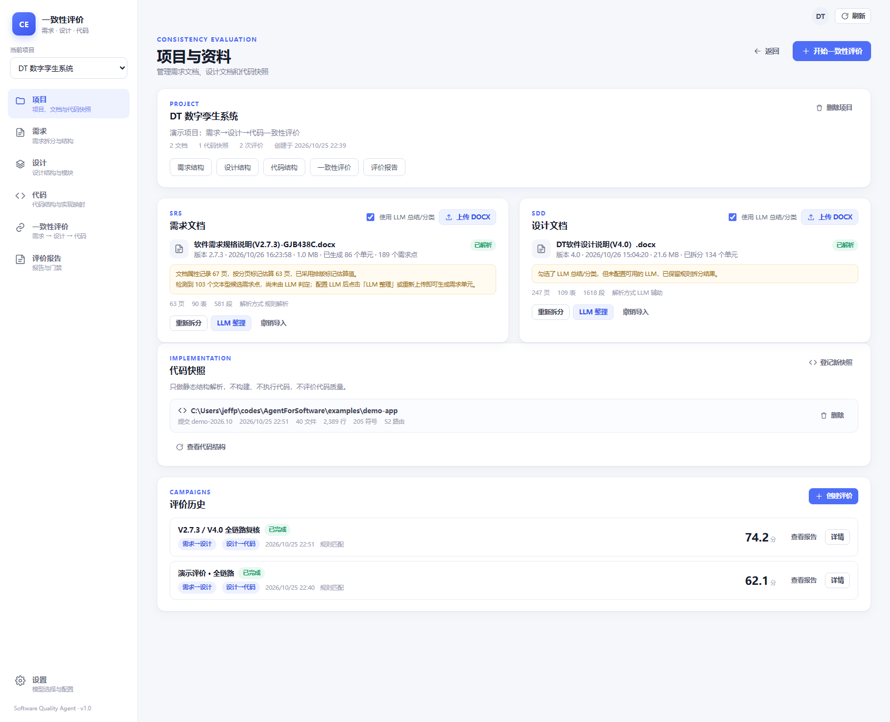
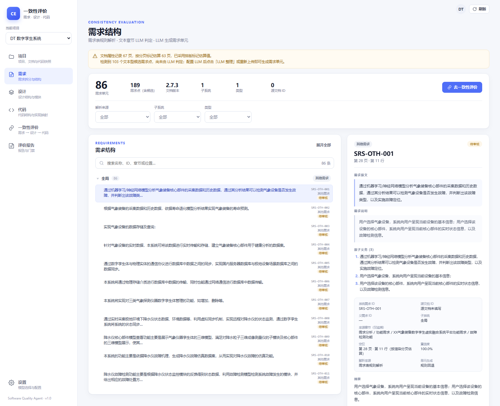
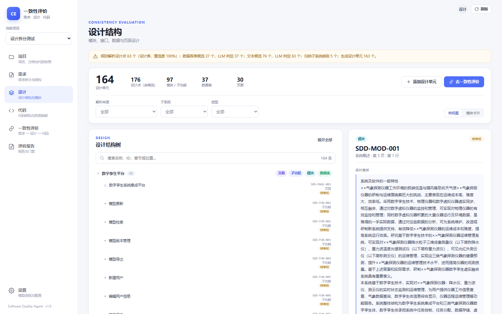
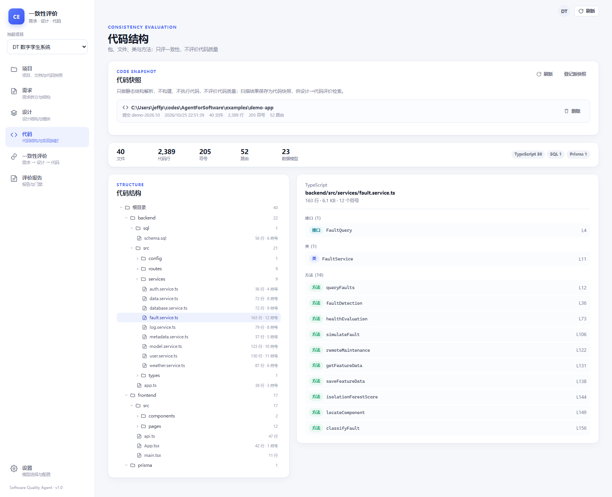
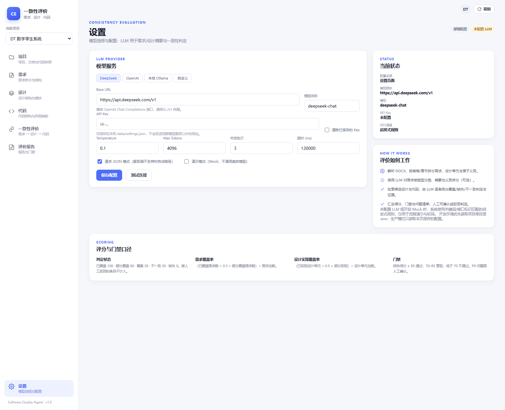

# 功能与界面

## 1. 页面总览

| 页面 | 主要能力 |
| --- | --- |
| 项目列表 | 新建项目、查看项目卡片 |
| 项目与资料 | 上传/重解析/LLM 整理 DOCX；登记代码快照；查看评价历史 |
| 需求结构 | 统计、筛选、搜索、分组树、详情、义务、审核、手工新增/删除 |
| 设计结构 | 树/卡片视图、详情、接口/输入输出/字段、审核、手工新增/删除 |
| 代码结构 | 语言/符号统计、目录树、文件符号、代码片段 |
| 一致性评价 | 创建任务、进度、总览、关系明细、义务覆盖矩阵、设计悬浮对比、人工审核 |
| 评价报告 | 报告列表、报告详情、打印/导出 |
| 设置 | LLM 配置、连接测试、开发/生产配置来源提示 |

截图位于 `docs/screenshots/`，仅作界面参考，可能随 UI 调整。

### 界面参考

## 2. 项目与资料

操作：

1. 创建项目；
2. 上传需求 DOCX（可选 LLM 整理）；
3. 上传设计 DOCX（可选 LLM 整理）；
4. 重新拆分文档；
5. LLM 整理；
6. 登记代码快照；
7. 查看评价历史。

界面会显示：

- 文档状态：已解析 / 解析中 / LLM 整理中 / 失败；
- 单元数、需求点/设计点数；
- 警告（无 LLM、解析异常、候选待判定等）；
- 最近评价得分。

## 3. 需求结构

- 按解析来源过滤：规则解析 / LLM 解析 / 手工添加；
- 按子系统、类型过滤；
- 搜索名称、ID、章节、位置；
- 按子系统分组；
- 详情展示需求原文、说明、原子义务、来源章节、定位、置信度、解析来源、单元生成方式；
- 人工修改类型、审核备注；
- 手工新增需求单元；
- 删除需求单元（同步移除对应需求点）；
- LLM 整理/任务运行期间自动轮询刷新。

## 4. 设计结构

- 树视图 / 卡片视图；
- 解析来源、子系统、类型过滤；
- 详情展示设计描述、摘要、义务、接口、输入输出、字段表、来源章节、定位；
- 审核设计单元；
- 手工新增/删除设计单元；
- 支持 `?focus=SDD-XXX` 直接定位设计单元。

## 5. 代码结构

- 快照元数据：路径、commit、文件/行/符号/路由/模型统计；
- 目录树；
- 文件符号明细；
- 代码片段；
- 语言分布。

## 6. 一致性评价

### 6.1 创建任务

- 选择层级：需求→设计、设计→代码、全链路；
- 选择子系统范围；
- 选择评价模式：经济（Top 4）/ 标准（Top 6）/ 精细（完整字段）；
- 可填写任务名；
- 创建后后台运行，前端每 1.5 秒轮询状态；
- 总览显示实际 LLM 调用数、输入/输出 token。

### 6.2 总览

展示：

- 一致性得分；
- 需求覆盖率；
- 设计实现覆盖率；
- 设计被需求追溯数量；
- 已覆盖/部分/缺失/不一致/偏离计数；
- 分子系统得分；
- P0/P1 计数；
- 门禁结论。

### 6.3 关系明细

- 层级、状态、子系统过滤；
- 搜索来源/目标；
- 每条关系显示来源、状态、置信度、目标；
- 右侧详情显示判定说明、证据、原子义务覆盖、缺口、建议、关联设计；
- 点击设计 chip 在左侧打开悬浮对比窗；
- 人工确认/驳回/重置。

### 6.4 义务覆盖

对需求→设计关系显示：

- 联合覆盖率；
- 每条义务状态（已覆盖/部分/冲突/未覆盖）；
- 覆盖该义务的设计；
- 每个设计 chip 的贡献百分比。

## 7. 评价报告

- 报告列表；
- 报告详情；
- Markdown/CSV/JSON 导出；
- 浏览器打印/PDF；
- 报告包含总览、分桶、逐条明细、主要问题。

## 8. 设置

- Base URL、模型、API Key、温度、max tokens、并发、超时、JSON 模式；
- 连接测试；
- 开发环境 `.env` 接管时只读并提示；
- 生产环境保存到本机设置文件，密钥脱敏返回。

## 9. 交互约束

- LLM 整理期间禁止手工删除；
- 新上传会替换同项目同类型旧文档；
- 手工单元在重新拆分/LLM 整理后保留；
- 失败时显示可操作错误，不吞掉异常。

## 10. 示例数据与演示流程

示例统计只用于演示，会随文档版本、解析规则和模型变化：

- 需求示例：86 个规则需求点、103 个文本候选、合计 189 个需求点；
- 设计示例：63 个规则设计点、37 个数据库表候选、76 个文本候选、合计 176 个设计点；
- 本地 mock LLM 的一次设计结果：163 个设计单元（模块 83、子功能 13、数据表 37、页面 30）。

演示流程：

1. 新建项目；
2. 上传示例需求/设计 DOCX；
3. 登记 `examples/demo-app`；
4. 配置 LLM 后执行「LLM 整理」；
5. 创建需求→设计或全链路评价；
6. 查看义务覆盖、AgentRun 和报告。

`examples/demo-app` 不在当前工作区时，`pnpm smoke` 会跳过代码扫描，`pnpm eval:heuristic` 会报目录不存在。

## 11. 相关文档

- [产品需求与范围](产品需求与范围.md)
- [数据流](数据流.md)
- [配置与运行](配置与运行.md)
